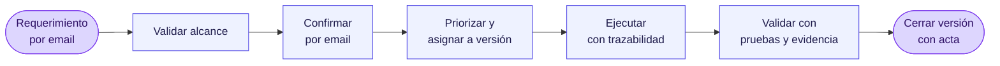

---
hide:
  - navigation
---

# OSTEL — Centro de Control del Proyecto

!!! abstract "Espacio único de seguimiento"
    Toda la información del proyecto de implementación de **PLEXO** en **OSTEL**, en un solo lugar: alcance, equipo, metodología, módulos y pendientes. Mantenido por el equipo de **ICORE**, accesible para OSTEL.

---

## :material-radar: Estado del proyecto

-   :material-progress-clock: **Estado actual**

    ---

    :material-circle:{ .lg .middle style="color: #f59e0b" } **Inicio — Kick off**

    Alineación de objetivos, equipo y forma de trabajo con OSTEL.

-   :material-flag-checkered: **Próximo hito**

    ---

    [**Kick Off**](kickoff.md) y confirmación por email de los acuerdos y de los 10 puntos críticos.

-   :material-chart-gantt: **Plan del programa**

    ---

    **9 módulos en 80 días hábiles**, en dos etapas: Etapa 1 en marcha al día 50, puesta en marcha integral al día 80.

    [:octicons-arrow-right-16: Ver plan](plan.md)

-   :material-calendar-clock: **Última actualización**

    ---

    **23 de noviembre 2026**

    Documentación viva — se actualiza al cierre de cada versión.

---

## :material-compass-outline: Accesos principales

-   :material-flag-checkered:{ .lg .middle } **Proyecto**

    ---

    Bases del trabajo conjunto entre ICORE y OSTEL.

    [:octicons-arrow-right-16: Kick Off](kickoff.md)
    [:octicons-arrow-right-16: Equipo](team.md)
    [:octicons-arrow-right-16: Metodología](methodology.md)

-   :material-chart-timeline-variant:{ .lg .middle } **Plan e iniciativas**

    ---

    Plan, estimaciones, estado de cada módulo y lo que el proyecto espera de OSTEL.

    [:octicons-arrow-right-16: Plan del programa y estimaciones](plan.md)
    [:octicons-arrow-right-16: Iniciativas](iniciativas.md)
    [:octicons-arrow-right-16: Pendientes de OSTEL](pendientes.md)

-   :material-progress-check:{ .lg .middle } **Seguimiento**

    ---

    Qué se acordó, qué se entrega en cada versión y cuántas horas se usaron.

    [:octicons-arrow-right-16: Minutas](minutas/index.md)
    [:octicons-arrow-right-16: Versiones](versiones/index.md)
    [:octicons-arrow-right-16: Consumo de horas](horas/index.md)

-   :material-file-document-multiple-outline:{ .lg .middle } **Documentos**

    ---

    Propuestas entregadas y formatos oficiales del proyecto.

    [:octicons-arrow-right-16: Propuestas](propuestas/index.md)
    [:octicons-arrow-right-16: Plantillas](plantillas/index.md)

-   :material-email-check-outline:{ .lg .middle } **Confirmaciones**

    ---

    Cómo se confirman acuerdos, propuestas y estimaciones.

    [:octicons-arrow-right-16: Confirmación por email](methodology.md#confirmacion-por-email)
    [:octicons-arrow-right-16: Referentes de OSTEL](team.md#referentes-de-ostel)

---

## :material-sitemap: Flujo operativo

1. **Registrar** el requerimiento recibido por email y validar alcance.
2. **Confirmar** propuesta y estimación por email.
3. **Priorizar** y asignar a la versión correspondiente.
4. **Ejecutar** el desarrollo con trazabilidad en GitHub.
5. **Validar** con pruebas funcionales y evidencia.
6. **Cerrar** la versión con acta y reporte de consumo.

---

## :material-account-group-outline: Qué revisar según tu rol

=== ":material-clipboard-text-outline: Referente de OSTEL"

    | Para qué | Ir a |
    |---|---|
    | Alinear objetivos y alcance | [Kick Off](kickoff.md) |
    | Saber quién es quién | [Equipo](team.md) |
    | Saber cómo aprobar | [Confirmación por email](methodology.md#confirmacion-por-email) |
    | Ver plazos y estimaciones | [Plan del programa](plan.md) |
    | Ver qué información falta enviar | [Pendientes de OSTEL](pendientes.md) |
    | Ver el consumo de horas | [Consumo de horas](horas/index.md) |

=== ":material-code-tags: Equipo ICORE"

    | Para qué | Ir a |
    |---|---|
    | Etapas y documentos de cada requerimiento | [Metodología](methodology.md#etapas-en-detalle) |
    | Responsabilidades por etapa | [Matriz de responsabilidades](team.md#matriz-de-responsabilidades-por-etapa) |
    | Estado de cada módulo | [Iniciativas](iniciativas.md) |
    | Formatos de minuta, estimación y cierre | [Plantillas](plantillas/index.md) |

---

## :material-map-marker-path: Navegación recomendada

!!! tip "Si recién empezás"
    [**Kick Off**](kickoff.md) :material-arrow-right: [**Equipo**](team.md) :material-arrow-right: [**Metodología**](methodology.md) :material-arrow-right: [**Iniciativas**](iniciativas.md)

    Cuatro páginas y tenés el contexto completo para participar.
