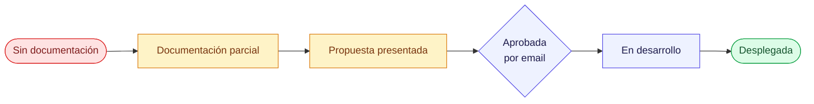

# :material-puzzle-outline: Iniciativas

!!! abstract "Mapa de módulos y acceso a la documentación funcional"
    OSTEL pidió **nueve módulos** sobre PLEXO. Cada uno tiene su estado, su documento funcional y el acceso directo a sus Issues en GitHub. Lo que no figura en el documento funcional aprobado de un módulo está fuera de su alcance.

!!! warning "Estado de la documentación"
    Los módulos **1 a 4** tienen documentación funcional **parcial**, con validaciones pendientes de OSTEL. Los módulos **5 a 9** todavía **no tienen documentación**: hasta recibirla no se pueden analizar, proponer ni estimar. Ver [Pendientes de OSTEL](pendientes.md).

---

## :material-view-dashboard-outline: Resumen

| # | Módulo | Estado | Plan (días hábiles) | Documento funcional | Issues | Pendientes |
|:-:|---|---|:-:|---|---|---|
| 1 | :material-account-group-outline: **Padrón, Afiliaciones y Aportes** | :material-circle:{ style="color: #f59e0b" } Parcial — validación pendiente | 1 – 25 | Pendiente de publicación | [Ver](https://github.com/I-CORE-TEC/plexo/issues?q=label%3Am1-padron) | [Ver](pendientes.md#m1) |
| 2 | :material-ticket-outline: **Mesa de Entradas** | :material-circle:{ style="color: #f59e0b" } Parcial — validación pendiente | 1 – 25 | Pendiente de publicación | [Ver](https://github.com/I-CORE-TEC/plexo/issues?q=label%3Am2-mesa-entradas) | [Ver](pendientes.md#m2) |
| 3 | :material-stethoscope: **Auditoría Médica** | :material-circle:{ style="color: #f59e0b" } Parcial — validación pendiente | 16 – 40 | Pendiente de publicación | [Ver](https://github.com/I-CORE-TEC/plexo/issues?q=label%3Am3-autorizaciones) | [Ver](pendientes.md#m3) |
| 4 | :material-cash-multiple: **Liquidaciones y Reintegros** | :material-circle:{ style="color: #f59e0b" } Parcial — validación pendiente | 31 – 50 | Pendiente de publicación | [Ver](https://github.com/I-CORE-TEC/plexo/issues?q=label%3Am4-liquidaciones) | [Ver](pendientes.md#m4) |
| 5 | :material-wheelchair-accessibility: **Integración / Discapacidad** | :material-circle:{ style="color: #dc2626" } Sin documentación | 41 – 60 (*) | Pendiente de OSTEL | [Ver](https://github.com/I-CORE-TEC/plexo/issues?q=label%3Am5-discapacidad) | [Ver](pendientes.md#m5) |
| 6 | :material-package-variant: **Compras y Suministros** | :material-circle:{ style="color: #dc2626" } Sin documentación | 51 – 70 (*) | Pendiente de OSTEL | [Ver](https://github.com/I-CORE-TEC/plexo/issues?q=label%3Am6-compras) | [Ver](pendientes.md#m6) |
| 7 | :material-chart-bar: **Estadísticas** | :material-circle:{ style="color: #dc2626" } Sin documentación | 61 – 80 (*) | Pendiente de OSTEL | [Ver](https://github.com/I-CORE-TEC/plexo/issues?q=label%3Am7-estadisticas) | [Ver](pendientes.md#m7) |
| 8 | :material-bank-outline: **Administración, Contabilidad y Finanzas** | :material-circle:{ style="color: #dc2626" } Sin documentación | 61 – 80 (*) | Pendiente de OSTEL | [Ver](https://github.com/I-CORE-TEC/plexo/issues?q=label%3Am8-administracion) | [Ver](pendientes.md#m8) |
| 9 | :material-scale-balance: **Legales** | :material-circle:{ style="color: #dc2626" } Sin documentación | 51 – 65 (*) | Pendiente de OSTEL | [Ver](https://github.com/I-CORE-TEC/plexo/issues?q=label%3Am9-legales) | [Ver](pendientes.md#m9) |

(*) Etapa 2: alcance preliminar, sujeto a la documentación de OSTEL. Ver [Plan del programa y estimaciones](plan.md).

---

## :material-file-document-edit-outline: Módulos con documentación parcial

=== "1 · Padrón, Afiliaciones y Aportes"

    **Objetivo:** que el padrón deje de ser una foto mensual y pase a ser un historial de movimientos con fecha de vigencia.

    - Alta, baja, reingreso, cambio de empresa y cambio de condición laboral como movimientos registrados.
    - Grupo familiar y vínculo con el titular.
    - Circuito de Futuros Afiliados, cierre mensual y alta efectiva.
    - Importación del padrón actual y proceso de bajas.

    **Pendiente:** validación de OSTEL y diccionario de datos del sistema actual.

=== "2 · Mesa de Entradas"

    **Objetivo:** una puerta única de entrada y salida para todos los trámites, con estado, responsable y tiempos.

    - Registro de trámites como tickets con estados (Recibido, En análisis, Pendiente de información, Escalado, Resuelto, Cerrado, Reabierto).
    - Bandejas por área y escalamiento.
    - Trámites de afiliados y soporte de uso de PLEXO sobre el mismo motor, en bandejas separadas.
    - Cerrar un ticket no ejecuta operaciones: la decisión de fondo se toma en Auditoría Médica (autorizar) y en Liquidaciones (pagar).

    **Pendiente:** validación de OSTEL.

=== "3 · Auditoría Médica"

    **Objetivo:** que cada pedido de autorización muestre en qué área está, quién lo resolvió y por qué.

    - Prácticas, internaciones, medicamentos de alto costo y prótesis.
    - Paso por Auditoría Administrativa, Auditoría Médica, Servicio Social y Gerencia.
    - Validaciones de cobertura contra el padrón (módulo 1).
    - Las autorizaciones vinculadas a discapacidad se coordinan con el módulo 5.

    **Pendiente:** validación de OSTEL.

=== "4 · Liquidaciones y Reintegros"

    **Objetivo:** ordenar el recorrido desde el pedido o la factura hasta el pago, con documentación y validaciones en cada paso.

    - Recepción de facturas de prestadores y débitos.
    - Reintegros a afiliados con su documentación, aprobación y pase a pago.
    - El pase a pago y los registros contables se coordinan con el módulo 8.

    **Pendiente:** validación de OSTEL.

---

## :material-folder-alert-outline: Módulos sin documentación

El alcance de estos módulos se define cuando OSTEL entregue su documentación: procesos actuales, normativa aplicable, formularios, reportes que se usan hoy y ejemplos reales (sin datos personales). Hasta entonces, la descripción es solo orientativa.

-   :material-wheelchair-accessibility:{ .lg .middle } **5 · Integración / Discapacidad**

    ---

    Prestaciones por discapacidad e integración escolar, con su documentación respaldatoria y su relación con la Superintendencia (SUR).

-   :material-package-variant:{ .lg .middle } **6 · Compras y Suministros**

    ---

    Pedidos, compras, proveedores e insumos de la obra social.

-   :material-chart-bar:{ .lg .middle } **7 · Estadísticas**

    ---

    Indicadores y reportes de gestión sobre los datos de los demás módulos.

-   :material-bank-outline:{ .lg .middle } **8 · Administración, Contabilidad y Finanzas**

    ---

    Circuitos administrativos, contables y financieros, incluidos recaudación, pagos, retenciones y conciliación bancaria.

-   :material-scale-balance:{ .lg .middle } **9 · Legales**

    ---

    Seguimiento de temas, reclamos y expedientes legales de la obra social.

---

## :material-cancel: Fuera del alcance actual

Estos temas no están incluidos en ningún módulo. Se revisan si aparecen al relevar los módulos 5 a 9, y en ese caso se estiman aparte:

- Intercambio en línea con ARCA, ANSES y la Superintendencia de Servicios de Salud.
- Portal del afiliado y portal de prestadores.
- Base de conocimiento, bots y WhatsApp Business.
- Lectura automática de documentos (OCR).

---

!!! note "Cómo se actualiza esta página"
    Cuando OSTEL aprueba por email el documento funcional de un módulo, se publica el enlace en la columna **Documento funcional** y el estado pasa a **Aprobada por email**. Cada versión posterior del documento se publica con su número de versión; la versión vigente es la última aprobada.
