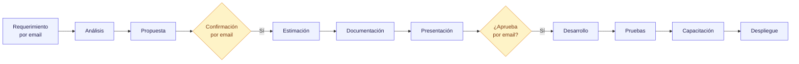
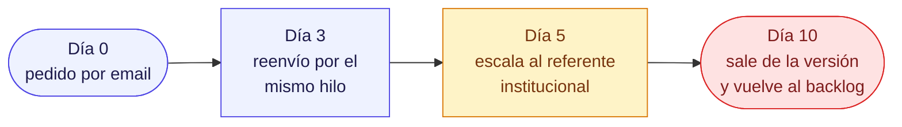
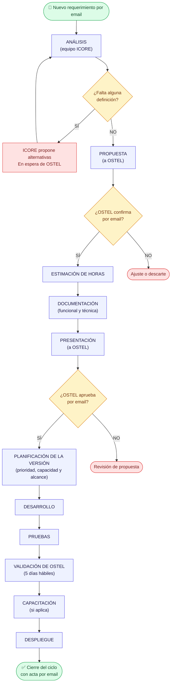

# :material-cog-sync-outline: Metodología de Trabajo

!!! abstract "Modelo de consumo de horas"
    El equipo de ICORE trabaja bajo un **paquete de horas** que OSTEL contrata al inicio o cuando lo necesita. Toda actividad —desde la reunión inicial hasta el despliegue— descuenta horas del saldo. Cada requerimiento sigue un flujo formal con etapas, documentación y trazabilidad. **Toda confirmación se realiza por email** y **ICORE no toma ninguna decisión sin el visto bueno previo de OSTEL**.

---

## :material-eye-outline: Visión general



---

## :material-clock-outline: Paquete de horas

<div class="grid cards" markdown>

-   :material-package-variant-closed:{ .lg .middle } **Contratación**

    OSTEL contrata un paquete de horas al inicio o cuando lo necesita.

-   :material-counter:{ .lg .middle } **Descuento**

    El saldo se descuenta según el tipo de actividad realizada.

-   :material-finance:{ .lg .middle } **Reporte**

    El equipo informa el consumo por email al cierre de cada etapa o versión.

-   :material-bell-alert-outline:{ .lg .middle } **Alerta de saldo**

    Cuando el saldo está por agotarse, se notifica por email para renovar o repriorizar.

</div>

### :material-clipboard-pulse-outline: Tipos de actividad que consumen horas

| :material-tag-outline: Actividad | Descripción |
|---|---|
| :material-account-voice: **Reunión** | Llamadas, videollamadas o encuentros presenciales de seguimiento o relevamiento |
| :material-clipboard-search-outline: **Análisis** | Estudio del requerimiento, relevamiento con referentes y revisión de impacto técnico y funcional |
| :material-database-sync-outline: **Datos y migración** | Revisión, depuración e importación de padrones y archivos del sistema actual |
| :material-code-braces: **Desarrollo** | Implementación y configuración de funcionalidades en PLEXO, correcciones y mejoras |
| :material-test-tube: **Pruebas** | Testing funcional, regresión y validación por parte del equipo |
| :material-school-outline: **Capacitación** | Entrenamiento a los usuarios clave de OSTEL sobre nuevas funcionalidades |
| :material-rocket-launch-outline: **Despliegue** | Puesta en producción, configuración y verificación post-deploy |

---

## :material-toolbox-outline: Herramientas de trabajo

El proyecto se apoya en **tres herramientas**: GitHub Issues para gestionar, este sitio para documentar y el email como canal oficial de confirmación.

=== ":material-github: GitHub Issues — gestión de requerimientos"

    **Repositorio:** [I-CORE-TEC/plexo](https://github.com/I-CORE-TEC/plexo)

    Cada requerimiento se registra como un **Issue** y se sigue en un **tablero de GitHub Projects**, que centraliza el estado de todos los ítems activos.

    | Tipo de ítem | Se crea como |
    |---|---|
    | :material-lightbulb-outline: Requerimiento nuevo | Issue con label `requerimiento` |
    | :material-bug-outline: Bug o corrección | Issue con label `bug` |
    | :material-test-tube: Documentación de pruebas | Issue con label `testing` |
    | :material-checkbox-marked-outline: Tarea interna | Issue con label `task` |
    | :material-timer-sand: Bloqueado por definición o información de OSTEL | Label adicional `espera-ostel` |

    Además, cada Issue lleva el label del módulo al que pertenece:

    | Módulo | Label |
    |---|---|
    | 1 · Padrón, Afiliaciones y Aportes | `m1-padron` |
    | 2 · Mesa de Entradas | `m2-mesa-entradas` |
    | 3 · Auditoría Médica | `m3-autorizaciones` |
    | 4 · Liquidaciones y Reintegros | `m4-liquidaciones` |
    | 5 · Integración / Discapacidad | `m5-discapacidad` |
    | 6 · Compras y Suministros | `m6-compras` |
    | 7 · Estadísticas | `m7-estadisticas` |
    | 8 · Administración, Contabilidad y Finanzas | `m8-administracion` |
    | 9 · Legales | `m9-legales` |

    !!! info "Ciclo de vida de un Issue (columnas del tablero)"
        ```
        Backlog → En análisis → Estimado → Aprobado
              → En desarrollo → En pruebas → Pendiente de validación de OSTEL → Cerrado

        En cualquier etapa: → En espera de OSTEL (con fecha de pedido)
        ```

    - Al recibir un requerimiento por email, se abre el Issue y se asigna al analista responsable.
    - La **estimación** de horas se registra en un campo del tablero y como comentario del Issue.
    - La **aprobación** de OSTEL llega **por email**; el PM deja constancia en el Issue (fecha, remitente y asunto del email).
    - Cuando un Issue pasa a **"En espera de OSTEL"**, se registra qué se pidió, a quién y en qué fecha, y se suma a [Pendientes de OSTEL](pendientes.md).
    - Al **cerrar** el Issue se indica el consumo real de horas.

=== ":material-book-open-page-variant-outline: GitHub Pages — documentación"

    **URL:** [i-core-tec.github.io/plexo](https://i-core-tec.github.io/plexo/)

    Punto de acceso centralizado para toda la documentación del proyecto. Accesible para el equipo de ICORE y los referentes de OSTEL.

    | Contenido publicado | Descripción |
    |---|---|
    | :material-note-text-outline: **Minutas de reunión** | Resumen de cada reunión: acuerdos, responsables y fechas |
    | :material-calendar-text-outline: **Definiciones de versión** | Objetivo, alcance e ítems comprometidos por iteración |
    | :material-puzzle-outline: **Documentación funcional** | Acceso a flujos, pantallas y reglas de negocio de cada módulo, desde [Iniciativas](iniciativas.md) |
    | :material-chart-gantt: **Plan y estimaciones** | Plan del programa en días hábiles y estado de la estimación de cada módulo, en [Plan del programa](plan.md) |
    | :material-timer-sand: **Pendientes de OSTEL** | Información y confirmaciones en espera, con fecha de pedido |
    | :material-clock-check-outline: **Consumo de horas** | Saldo del paquete y consumo por versión, en [Consumo de horas](horas/index.md) |
    | :material-file-check-outline: **Actas de cierre** | Confirmación de despliegue y cierre de cada ciclo |
    | :material-file-document-multiple-outline: **Plantillas** | Formatos oficiales de minuta, estimación, pruebas y cierre, en [Plantillas](plantillas/index.md) |

    !!! tip "Regla de oro"
        Todo documento que requiera validación o referencia futura se publica en este sitio, y su aprobación se confirma por email.

=== ":material-email-outline: Email — canal oficial"

    El email es el **único canal válido para confirmar**. Ver el detalle en [Confirmación por email](#confirmacion-por-email).

    | Se usa para | Quién envía |
    |---|---|
    | :material-email-arrow-right-outline: Enviar un requerimiento | Referente de OSTEL |
    | :material-email-check-outline: Acusar recibo | PM de ICORE |
    | :material-email-edit-outline: Enviar propuesta, estimación o minuta | PM / Analista de ICORE |
    | :material-email-seal-outline: Aprobar o rechazar | Referente institucional de OSTEL |
    | :material-email-alert-outline: Informar consumo, esperas y alertas de saldo | PM de ICORE |

---

## :material-email-check-outline: Confirmación por email { #confirmacion-por-email }

!!! danger "Sin email de confirmación, no hay acuerdo"
    Reuniones, llamadas y chats sirven para conversar y aclarar. **Lo que vale es el email.** Ninguna propuesta, estimación, cambio de alcance o despliegue avanza sin su confirmación escrita.

### :material-format-list-checks: Qué se confirma por email

| Momento | Qué se confirma | Quién confirma |
|---|---|---|
| :material-flag-checkered: Kick off | Acuerdos, referentes y casillas oficiales | Referente institucional |
| :material-note-text-outline: Cada reunión | Minuta: acuerdos, responsables y fechas | Referente que participó |
| :material-compass-outline: Definición faltante | La alternativa elegida entre las propuestas por ICORE | Referente del módulo o institucional |
| :material-clipboard-text-outline: Propuesta | Que la solución propuesta responde a la necesidad | Referente institucional |
| :material-calculator-variant-outline: Estimación | Horas estimadas y descuento del saldo | Referente institucional |
| :material-calendar-week-outline: Versión | Alcance comprometido de la versión | Referente institucional |
| :material-swap-horizontal: Cambio de alcance | Nuevo análisis y estimación | Referente institucional |
| :material-check-decagram-outline: Validación | Resultado de las pruebas de cada flujo | Referente del módulo |
| :material-rocket-launch-outline: Despliegue | Ventana de despliegue y acta de cierre | Referente institucional |

### :material-email-edit-outline: Cómo se arma cada email

- **Asunto con formato fijo:** `[OSTEL] <Tipo> — #<número de Issue> <título>`
  Ejemplos: `[OSTEL] Aprobación de estimación — #12 Importación del padrón` · `[OSTEL] Minuta — Kick off`
- **Destinatarios:** el referente que debe confirmar, con copia al PM de ICORE y a las casillas oficiales acordadas.
- **Cuerpo:** qué se pide confirmar, enlace a la página de este sitio o al Issue, y fecha esperada de respuesta.
- **Sin datos personales:** los emails no llevan padrones ni datos de afiliados adjuntos; esos archivos van por el repositorio seguro.

### :material-check-circle-outline: Qué cuenta como confirmación válida

1. :material-numeric-1-circle-outline: Una **respuesta explícita** al email ("Apruebo", "Confirmado", "No apruebo porque…").
2. :material-numeric-2-circle-outline: Enviada desde una **casilla oficial** registrada en [Equipo](team.md#referentes-de-ostel).
3. :material-numeric-3-circle-outline: Que responda **sobre el mismo hilo** del pedido, para mantener la trazabilidad.

!!! warning "El silencio no es aprobación"
    Si no hay respuesta, se aplica el [esquema de escalamiento](#plazos-de-respuesta-y-escalamiento). Mientras tanto, el ítem queda **"En espera de OSTEL"**, no consume horas de desarrollo y los plazos asociados se corren.

### :material-file-document-multiple-outline: Modelos de email

=== "Acuse de recibo"

    ```text
    Asunto: [OSTEL] Acuse de recibo — #<n> <título>

    Hola <nombre>:
    Recibimos el requerimiento "<título>". Quedó registrado como #<n>
    y está asignado a <analista> para su análisis.
    Te avisamos por este mismo hilo cuando tengamos la propuesta.

    Saludos,
    <PM> — ICORE
    ```

=== "Pedido de definición"

    ```text
    Asunto: [OSTEL] Definición requerida — #<n> <título>

    Hola <nombre>:
    Para avanzar con "<título>" necesitamos que nos indiquen cómo seguir:
    - Opción A: <descripción> — impacto: <horas / plazo>
    - Opción B: <descripción> — impacto: <horas / plazo>
    Hasta recibir su respuesta por este hilo, el ítem queda en espera
    y no se avanza con ninguna de las opciones.
    Fecha esperada de respuesta: <fecha>.

    Saludos,
    <PM> — ICORE
    ```

=== "Pedido de aprobación"

    ```text
    Asunto: [OSTEL] Aprobación de estimación — #<n> <título>

    Hola <nombre>:
    Te compartimos la propuesta y la estimación de "<título>":
    - Documento: <enlace al sitio>
    - Estimación: <rango> horas (saldo actual: <horas> horas)
    Necesitamos tu confirmación por este hilo antes del <fecha>
    para incluirlo en la próxima versión.

    Saludos,
    <PM> — ICORE
    ```

=== "Respuesta de OSTEL"

    ```text
    Asunto: RE: [OSTEL] Aprobación de estimación — #<n> <título>

    Apruebo la propuesta y la estimación de <rango> horas para "<título>".

    <nombre> — <rol> — OSTEL
    ```

---

## :material-scale-balance: Plazos, dependencias y responsabilidades { #plazos-dependencias-y-responsabilidades }

!!! abstract "Por qué existe esta sección"
    El avance del proyecto depende tanto del trabajo de ICORE como de las definiciones, la documentación y las validaciones de OSTEL. Estas reglas dejan claro qué le corresponde a cada parte y cómo impactan las esperas en los plazos.

### :material-timer-alert-outline: Plazos de respuesta y escalamiento { #plazos-de-respuesta-y-escalamiento }



| Días hábiles sin respuesta | Qué pasa |
|:-:|---|
| **0** | El pedido sale por email con fecha esperada de respuesta. El Issue pasa a "En espera de OSTEL" y se agrega a [Pendientes de OSTEL](pendientes.md). |
| **3** | El PM reenvía el pedido por el mismo hilo. |
| **5** | El PM escala el pedido al referente institucional. |
| **10** | El ítem sale de la versión en curso y vuelve al backlog. Se replanifica cuando llegue la respuesta, según la capacidad disponible en ese momento. |

### :material-link-variant: Dependencias de OSTEL

1. **Las demoras corren los plazos.** Toda entrega que dependa de información, documentación, accesos o confirmaciones de OSTEL se corre en la misma cantidad de días que demore esa dependencia.
2. **Las esperas son visibles.** Cada pedido pendiente figura en [Pendientes de OSTEL](pendientes.md) con su fecha de pedido y responsable.
3. **El informe de cierre de cada versión** detalla, junto al consumo de horas, los días de espera atribuibles a dependencias de OSTEL.
4. **Accesos, usuarios y ambientes** que deba proveer OSTEL se entregan en la fecha comprometida; si no, aplica la regla 1.

### :material-database-check-outline: Documentación y datos

1. **La documentación de origen la entrega OSTEL.** Procesos, normativas, códigos, circuitos y ejemplos son responsabilidad de OSTEL. Si hay que relevar algo que no está documentado, ese relevamiento es una actividad que consume horas y requiere estimación aprobada.
2. **La calidad del dato de origen es responsabilidad de OSTEL.** ICORE migra la información tal como la recibe, informa cada inconsistencia detectada y aplica el tratamiento que OSTEL decida por email.
3. **Lo que no está en la documentación aprobada está fuera de alcance**, aunque se haya mencionado en una reunión.
4. **Un cambio sobre una definición ya aprobada es un cambio de alcance**, sin importar su tamaño: inicia un nuevo ciclo de análisis, estimación y confirmación.

### :material-bug-check-outline: Bug o cambio

<div class="grid cards" markdown>

-   :material-bug-outline: **Es un bug cuando…**

    ---

    La funcionalidad **no cumple un criterio de aceptación aprobado** por OSTEL.

    Se corrige dentro de las horas ya estimadas.

-   :material-swap-horizontal: **Es un cambio cuando…**

    ---

    Se pide algo **distinto, adicional o que no estaba** en los criterios de aceptación aprobados.

    Sigue el ciclo completo y consume horas nuevas.

</div>

### :material-check-decagram-outline: Validación de entregas

1. OSTEL valida cada entrega dentro de los **5 días hábiles** posteriores a su presentación.
2. Si la validación no llega en ese plazo, el ítem queda **"Pendiente de validación de OSTEL"**: las horas consumidas se informan igual y el equipo continúa con los siguientes ítems de la versión.
3. Las observaciones que lleguen después de ese plazo se registran como un **ítem nuevo** y se planifican en una próxima versión.

### :material-shield-check-outline: Garantía post-despliegue

Los bugs detectados dentro de los **30 días corridos** posteriores al despliegue de una funcionalidad se corrigen sin consumo de horas. Pasado ese plazo, toda corrección consume horas del paquete.

### :material-school-outline: Capacitación

ICORE capacita a los **usuarios clave** designados por OSTEL y entrega material de apoyo. Los usuarios clave son responsables de replicar la capacitación dentro de su área. Las capacitaciones adicionales se estiman y consumen horas.

---

## :material-source-branch: Flujo de trabajo



!!! note "Importante"
    Una vez aprobado, el requerimiento **no entra automáticamente en desarrollo**: primero se incorpora al backlog priorizado y se confirma en la **planificación de la versión** según prioridad, capacidad del equipo, dependencias y compromisos ya asumidos.

---

## :material-format-list-numbered: Etapas en detalle { #etapas-en-detalle }

??? abstract "1 — Recepción del requerimiento"
    - OSTEL envía el requerimiento **por email** desde una casilla oficial.
    - El equipo acusa recibo por el mismo hilo **dentro de las 24 horas hábiles**.
    - Se crea un **Issue en GitHub** con título, descripción completa, label `requerimiento` y label del módulo.
    - Se asigna un analista responsable y el Issue pasa a **"En análisis"**.

??? abstract "2 — Análisis"
    - El equipo estudia el requerimiento: impacto funcional, técnico, sobre los datos y sobre procesos existentes.
    - Se identifican dudas o ambigüedades y se piden aclaraciones por email al referente del módulo.
    - Si falta una definición, ICORE propone alternativas con su impacto y **espera la decisión de OSTEL por email**; no avanza con ninguna por su cuenta.
    - El analista puede convocar las reuniones que considere necesarias hasta tener una comprensión **completa y concreta** del requerimiento. Cada reunión consume horas del paquete y deja minuta.
    - Si el requerimiento depende de documentación o archivos pendientes de OSTEL, pasa a **"En espera de OSTEL"** hasta recibirlos.

    !!! info "Consume horas desde que comienza el análisis"

??? abstract "3 — Propuesta"
    - El equipo redacta una propuesta de solución con el alcance definido: flujos, pantallas y reglas de negocio.
    - Se agenda una reunión breve para presentarla y luego se envía por email.
    - OSTEL puede **aceptar, pedir ajustes o descartar** el requerimiento, siempre respondiendo por email.

??? abstract "4 — Estimación"
    - Con la propuesta confirmada, el equipo estima las horas por etapa: análisis, desarrollo, pruebas, despliegue y capacitación.
    - La estimación se presenta como **rango** (ej.: 8–12 horas) para contemplar variabilidad.
    - Se verifica que haya saldo suficiente o se solicita renovación del paquete.
    - La estimación se registra en el Issue y se envía por email para su aprobación.

??? abstract "5 — Documentación"
    Se genera la documentación técnica y funcional del requerimiento:

    - Descripción del problema y solución propuesta
    - Flujos y pantallas
    - Reglas de negocio
    - Criterios de aceptación
    - Alcance y exclusiones
    - Estimación de horas por etapa

    La documentación queda accesible desde [Iniciativas](iniciativas.md) para todo el equipo.

??? abstract "6 — Presentación y aprobación"
    - Se presenta la documentación a OSTEL en una reunión formal.
    - La **minuta** (acuerdos, responsables, fecha) se publica en este sitio y se envía por email.
    - El referente institucional confirma **por email** su aprobación.
    - El PM deja constancia de la aprobación en el Issue y lo pasa a **"Aprobado"**.

    !!! warning "Sin email de aprobación, no se inicia el desarrollo."

??? abstract "7 — Planificación de la versión"
    - El requerimiento aprobado se incorpora al backlog priorizado.
    - En la planificación de la próxima versión se evalúa: prioridad, capacidad del equipo, dependencias y compromisos ya asumidos.
    - El alcance de la versión se envía por email y se confirma antes de empezar.

    !!! info "El backlog no es FIFO: se prioriza por impacto y dependencias."

??? abstract "8 — Desarrollo"
    - El equipo implementa la solución en PLEXO según lo documentado y aprobado.
    - Se registran las horas consumidas por tarea.
    - El Issue avanza a **"En desarrollo"**.

    !!! warning "Cambios de alcance durante el desarrollo requieren un nuevo ciclo de análisis, estimación y confirmación por email."

??? abstract "9 — Pruebas y validación"
    - El equipo realiza pruebas **funcionales y de regresión**, con datos de prueba (nunca con datos reales de afiliados fuera del ambiente acordado).
    - Se documenta el resultado por criterio de aceptación y se publica en este sitio.
    - El referente del módulo valida los flujos clave y confirma el resultado por email dentro de los **5 días hábiles**.
    - Si hay observaciones dentro de los criterios aprobados, se corrigen y se vuelven a probar dentro del bloque de horas estimado (salvo que el volumen lo supere).

??? abstract "10 — Capacitación"
    - Se realiza solo cuando la funcionalidad lo requiere, a los usuarios clave designados por OSTEL.
    - Puede ser presencial, por videollamada o mediante documentación de usuario.
    - Se agenda por email con anticipación y consume horas del paquete.

??? abstract "11 — Despliegue"
    - La ventana de despliegue se acuerda por email.
    - El equipo despliega en el entorno productivo y verifica el funcionamiento post-deploy.
    - El **acta de cierre** se publica en este sitio y se envía por email para su confirmación.
    - El Issue se cierra en GitHub con el consumo real de horas registrado.
    - Desde el despliegue corren los **30 días corridos** de garantía.

---

## :material-file-tree-outline: Documentación producida en cada etapa

| Etapa | Documento generado | Dónde se publica | Confirmación por email |
|---|---|---|:-:|
| :material-email-outline: Recepción | Issue creado + acuse de recibo | GitHub (Issue) + email | — |
| :material-clipboard-search-outline: Análisis | Notas de relevamiento / pedidos de definición | GitHub (Issue) + email | :material-check: si hay definiciones |
| :material-clipboard-text-outline: Propuesta | Propuesta de solución | GitHub (Issue) + email | :material-check: |
| :material-calculator-variant-outline: Estimación | Estimación de horas por etapa | GitHub (Issue) + email | :material-check: |
| :material-book-open-page-variant-outline: Documentación | Documento funcional y técnico | **GitHub Pages → Iniciativas** | — |
| :material-presentation: Presentación | Minuta de reunión | **GitHub Pages** + email | :material-check: |
| :material-calendar-week-outline: Planificación | Definición de la versión | **GitHub Pages** + email | :material-check: |
| :material-test-tube: Pruebas | Reporte de pruebas por criterio | **GitHub Pages** + email | :material-check: |
| :material-rocket-launch-outline: Despliegue | Acta de cierre del ciclo | **GitHub Pages** + email | :material-check: |

---

## :material-shield-check-outline: Reglas generales

!!! danger "Reglas que no se negocian"

    1. :material-numeric-1-circle-outline: **OSTEL decide, ICORE propone.** ICORE no toma ninguna decisión funcional, de alcance, de datos ni de prioridad sin el visto bueno previo de OSTEL por email.
    2. :material-numeric-2-circle-outline: **Toda confirmación es por email.** Acuerdos, aprobaciones y cambios valen solo si se confirman por email desde una casilla oficial. Reuniones, llamadas y chats no tienen validez contractual.
    3. :material-numeric-3-circle-outline: **Sin aprobación no hay desarrollo.** El equipo no inicia el desarrollo sin el email de aprobación de OSTEL.
    4. :material-numeric-4-circle-outline: **Las esperas corren los plazos.** Toda demora en información, documentación, accesos o validaciones de OSTEL corre las entregas en la misma medida.
    5. :material-numeric-5-circle-outline: **Cambios de alcance reinician el ciclo.** Si OSTEL pide cambios sobre un requerimiento ya aprobado, se genera un nuevo ciclo de análisis, estimación y confirmación.
    6. :material-numeric-6-circle-outline: **Toda actividad se registra.** Reuniones, análisis, desarrollo, pruebas y despliegue siempre generan un registro de horas consumidas.
    7. :material-numeric-7-circle-outline: **Transparencia en el consumo.** OSTEL puede pedir su saldo y el detalle de consumo en cualquier momento.
    8. :material-numeric-8-circle-outline: **Datos personales protegidos.** Los datos de afiliados se intercambian solo por el repositorio seguro acordado y nunca se publican en Issues, en este sitio ni por mensajería (Ley 25.326).

---

## :material-calendar-week-outline: Planificación por versiones

El trabajo se organiza en **versiones**: iteraciones de duración variable que agrupan un conjunto de requerimientos priorizados y aprobados.

<div class="grid cards" markdown>

-   :material-timer-outline: **Duración variable**

    Se acuerda con OSTEL según la complejidad del alcance de cada versión.

-   :material-bullseye-arrow: **Alcance definido**

    Al comenzar la versión se define qué ítems del backlog se comprometen y se confirma por email.

-   :material-lock-outline: **Foco protegido**

    Durante la versión el equipo trabaja únicamente sobre los ítems comprometidos. Los cambios se tratan en la siguiente versión.

-   :material-presentation-play: **Revisión al cierre**

    Reunión final con OSTEL para presentar lo entregado, validar resultados y planificar el siguiente ciclo.

-   :material-counter: **Consumo informado**

    Al cierre de cada versión se informa por email el consumo real de horas y los días de espera por dependencias de OSTEL.

-   :material-link-variant: **Trazabilidad pública**

    La definición y el estado de cada versión se publican en este sitio y se siguen en el tablero de **GitHub Projects**.

</div>
