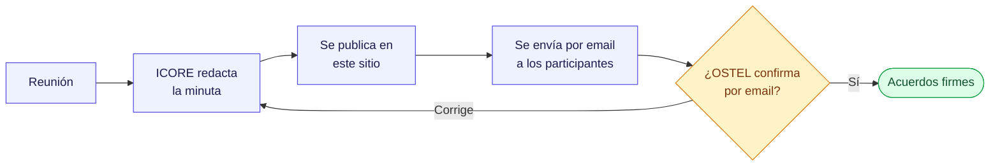

---
hide:
  - navigation
---

# :material-note-multiple-outline: Minutas de reunión

!!! abstract "Trazabilidad de acuerdos"
    En esta sección se publican las minutas formales del proyecto: participantes, decisiones tomadas, dependencias detectadas y próximos pasos acordados entre ICORE y OSTEL.

---

## :material-timeline-text-outline: Registro publicado

| Fecha | Reunión | Estado | Documento |
|---|---|---|---|
| A confirmar | Kick off ICORE / OSTEL | :material-circle:{ style="color: #f59e0b" } Próxima | Se publica dentro de las 24 h posteriores a la reunión |

---

## :material-email-check-outline: Cómo se confirma una minuta

---

## :material-clipboard-check-outline: Criterio de publicación

- Toda minuta deja explícitos los **acuerdos, responsables, fechas y pendientes**.
- Se publica dentro de las **24 horas hábiles** posteriores a la reunión y se envía por email con asunto `[OSTEL] Minuta — <reunión>`.
- Los acuerdos se consideran firmes recién cuando OSTEL **confirma la minuta por email**.
- Si un dato no fue confirmado en la reunión, se publica como pendiente y se suma a [Pendientes de OSTEL](../pendientes.md); no se inventa.
- Las minutas no incluyen datos personales de afiliados.
- Se agregan en orden cronológico y siguen la [plantilla de minuta](../plantillas/minuta-reunion.md).
