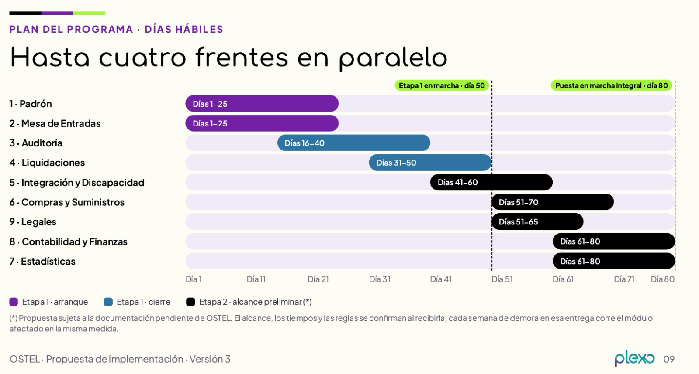

# :material-chart-gantt: Plan del programa y estimaciones

!!! abstract "Plan de referencia en días hábiles"
    El programa completo se organiza en **dos etapas y 80 días hábiles**, con **hasta cuatro frentes en paralelo**. La Etapa 1 deja en marcha los módulos 1 a 4 al **día 50**; la Etapa 2 completa la **puesta en marcha integral al día 80**. Es el plan de la *Propuesta de implementación — Versión 3* presentada a OSTEL.

!!! warning "(*) Plan sujeto a la documentación pendiente de OSTEL"
    El alcance, los tiempos y las reglas se confirman al recibir la documentación de cada módulo. **Cada semana de demora en esa entrega corre el módulo afectado en la misma medida.** La Etapa 2 es un **alcance preliminar**: sus módulos todavía no tienen documentación (ver [Pendientes de OSTEL](pendientes.md)).

---

## :material-calendar-range: Plan del programa

| # | Módulo | Etapa | Días hábiles | Duración |
|:-:|---|---|:-:|:-:|
| 1 | :material-account-group-outline: Padrón, Afiliaciones y Aportes | :material-circle:{ style="color: #7c3aed" } Etapa 1 · arranque | 1 – 25 | 25 días |
| 2 | :material-ticket-outline: Mesa de Entradas | :material-circle:{ style="color: #7c3aed" } Etapa 1 · arranque | 1 – 25 | 25 días |
| 3 | :material-stethoscope: Auditoría Médica | :material-circle:{ style="color: #2563eb" } Etapa 1 · cierre | 16 – 40 | 25 días |
| 4 | :material-cash-multiple: Liquidaciones y Reintegros | :material-circle:{ style="color: #2563eb" } Etapa 1 · cierre | 31 – 50 | 20 días |
| 5 | :material-wheelchair-accessibility: Integración y Discapacidad | :material-circle:{ style="color: #111827" } Etapa 2 · preliminar (*) | 41 – 60 | 20 días |
| 6 | :material-package-variant: Compras y Suministros | :material-circle:{ style="color: #111827" } Etapa 2 · preliminar (*) | 51 – 70 | 20 días |
| 9 | :material-scale-balance: Legales | :material-circle:{ style="color: #111827" } Etapa 2 · preliminar (*) | 51 – 65 | 15 días |
| 8 | :material-bank-outline: Administración, Contabilidad y Finanzas | :material-circle:{ style="color: #111827" } Etapa 2 · preliminar (*) | 61 – 80 | 20 días |
| 7 | :material-chart-bar: Estadísticas | :material-circle:{ style="color: #111827" } Etapa 2 · preliminar (*) | 61 – 80 | 20 días |

---

## :material-flag-variant-outline: Hitos

-   :material-flag-checkered:{ .lg .middle } **Día 50 — Etapa 1 en marcha**

    ---

    Padrón, Mesa de Entradas, Auditoría Médica y Liquidaciones y Reintegros funcionando.

    Depende de: validación de la documentación de los módulos 1 a 4 (P-18) y del diccionario de datos del padrón (P-07 a P-14).

-   :material-flag-triangle:{ .lg .middle } **Día 80 — Puesta en marcha integral**

    ---

    Los nueve módulos funcionando.

    Depende de: documentación de los módulos 5 a 9 (P-20 a P-24), con fecha de entrega acordada por módulo (P-19).

!!! info "¿Cuándo es el día 1?"
    El día 1 se fija cuando OSTEL confirma por email el inicio del proyecto, después del kick off. Desde ese email, los días se cuentan en días hábiles.

### Por qué así

- **Padrón y Mesa de Entradas arrancan primero** porque todo lo demás depende de ellos: Auditoría valida cobertura contra el padrón, y todos los trámites entran por Mesa de Entradas.
- **Auditoría y Liquidaciones se solapan con los primeros** para aprovechar el relevamiento ya hecho y llegar al día 50 con la Etapa 1 completa.
- **La Etapa 2 arranca cuando la Etapa 1 se estabiliza**, y con la documentación de cada módulo ya recibida. Sin documentación no se puede relevar ni construir.

---

## :material-calculator-variant-outline: Cómo se estima

El plan de días hábiles es la **referencia del programa**. Dentro de cada módulo, cada requerimiento se estima en **horas** y se descuenta del [paquete de horas](methodology.md#paquete-de-horas).

-   :material-arrow-expand-horizontal: **En rango**

    ---

    Cada estimación tiene un mínimo y un máximo (ej.: 8–12 horas) para contemplar la variabilidad.

-   :material-format-list-numbered: **Por etapa**

    ---

    Análisis, documentación, desarrollo, pruebas, capacitación y despliegue, cada una con sus horas.

-   :material-shield-check-outline: **Con supuestos**

    ---

    Toda estimación declara de qué depende. Si un supuesto cambia, la estimación se revisa.

-   :material-email-check-outline: **Aprobada por email**

    ---

    OSTEL aprueba cada estimación por email antes de que se descuente una sola hora de desarrollo.

[:material-file-document-outline: Ver plantilla de estimación](plantillas/estimacion.md){ .md-button }

---

## :material-list-status: Estado de la estimación por módulo

| Módulo | Documentación | Estimación |
|---|---|---|
| 1 · Padrón, Afiliaciones y Aportes | :material-circle:{ style="color: #f59e0b" } Parcial | Plan de referencia (25 días). Se estima en horas al validar la documentación. |
| 2 · Mesa de Entradas | :material-circle:{ style="color: #f59e0b" } Parcial | Plan de referencia (25 días). Se estima en horas al validar la documentación. |
| 3 · Auditoría Médica | :material-circle:{ style="color: #f59e0b" } Parcial | Plan de referencia (25 días). Se estima en horas al validar la documentación. |
| 4 · Liquidaciones y Reintegros | :material-circle:{ style="color: #f59e0b" } Parcial | Plan de referencia (20 días). Se estima en horas al validar la documentación. |
| 5 a 9 | :material-circle:{ style="color: #dc2626" } Sin documentación | Preliminar (*). Se estima al recibir su documentación. |

!!! tip "Lo que hace que el plan se cumpla"
    Que OSTEL valide la documentación de los módulos 1 a 4, entregue la de los módulos 5 a 9 en las fechas acordadas y responda dentro de los [plazos de la metodología](methodology.md#plazos-de-respuesta-y-escalamiento).
