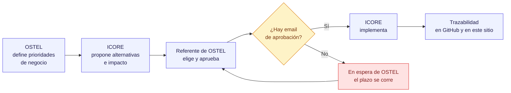

# :material-account-group: Equipo del proyecto

!!! abstract "Quién hace qué"
    Esta sección identifica al equipo asignado al proyecto y cómo se organiza el trabajo entre **OSTEL** y el equipo de implementación de **ICORE** sobre la plataforma **PLEXO**.

---

## :material-card-account-details-outline: Equipo ICORE

-   :material-account-tie:{ .lg .middle } **Matías Abate**

    ---

    **Rol:** Project Manager 
    **Email:** a confirmar 
    **Enfoque:** Seguimiento general del proyecto, planificación de versiones, control del paquete de horas, priorización con OSTEL y punto de contacto formal.

-   :material-clipboard-text-search-outline:{ .lg .middle } **Matías Fariña**

    ---

    **Rol:** Analista Funcional 
    **Email:** [mfarina@i-core.com.ar](mailto:mfarina@i-core.com.ar) 
    **Enfoque:** Relevamiento con los referentes de OSTEL, reglas de negocio, propuestas funcionales, criterios de aceptación y pruebas.

-   :material-clipboard-text-search-outline:{ .lg .middle } **Lisandro Lafuente**

    ---

    **Rol:** Analista Funcional 
    **Email:** a confirmar 
    **Enfoque:** Relevamiento con los referentes de OSTEL, reglas de negocio, propuestas funcionales, criterios de aceptación y pruebas.

-   :material-code-braces:{ .lg .middle } **Pablo Cao**

    ---

    **Rol:** Desarrollador Sr. 
    **Email:** [pablocao@i-core.com.ar](mailto:pablocao@i-core.com.ar) 
    **Enfoque:** Implementación y configuración de PLEXO, migración de datos y soporte de entregas.

-   :material-code-braces:{ .lg .middle } **Juani Portilla**

    ---

    **Rol:** Desarrollador Sr. 
    **Email:** a confirmar 
    **Enfoque:** Implementación y configuración de PLEXO, pruebas automatizadas, despliegues y rendimiento.

---

## :material-office-building-outline: Referentes de OSTEL { #referentes-de-ostel }

!!! warning "A confirmar en el kick off"
    Los referentes se designan en el kick off y se confirman **por email**. Solo las casillas registradas en esta tabla pueden enviar requerimientos y aprobar propuestas, estimaciones y cambios de alcance.

| Rol | Responsabilidad | Nombre | Email |
|---|---|---|---|
| :material-account-key-outline: **Referente institucional** | Aprobación final, prioridades de negocio y nexo con ICORE | A designar | A designar |
| :material-account-group-outline: **Afiliaciones / Padrón** | Reglas del padrón, altas, bajas, reingresos y cierre mensual | A designar | A designar |
| :material-inbox-arrow-down-outline: **Mesa de Entradas** | Tipos de trámite, circuito de recepción y respuesta al afiliado | A designar | A designar |
| :material-stethoscope: **Auditoría Médica** | Criterios de autorización, validaciones y excepciones | A designar | A designar |
| :material-cash-multiple: **Liquidaciones / Tesorería** | Facturación de prestadores, débitos, reintegros y pagos | A designar | A designar |
| :material-wheelchair-accessibility: **Integración / Discapacidad** | Prestaciones por discapacidad e integración, documentación y circuito actual | A designar | A designar |
| :material-package-variant: **Compras y Suministros** | Pedidos, compras, proveedores e insumos | A designar | A designar |
| :material-chart-bar: **Estadísticas** | Indicadores y reportes que necesita la gestión | A designar | A designar |
| :material-bank-outline: **Administración, Contabilidad y Finanzas** | Circuitos administrativos, contables y financieros | A designar | A designar |
| :material-scale-balance: **Legales** | Temas, reclamos y expedientes legales | A designar | A designar |

---

## :material-gavel: Principio de decisión: OSTEL decide, ICORE propone { #principio-de-decision }

!!! danger "ICORE no toma ninguna decisión sin el visto bueno previo de OSTEL"
    El equipo de ICORE no toma decisiones funcionales, de alcance, de datos ni de prioridad por cuenta propia. Cuando falta una definición, ICORE **propone** una o más alternativas con su impacto, pero **no aplica ninguna** hasta recibir la aprobación por email del referente de OSTEL que corresponda. Mientras tanto, el ítem queda en estado **"En espera de OSTEL"** y los plazos asociados se corren en la misma medida.

Esto aplica, entre otros casos, a:

- La interpretación de códigos, estados o datos del sistema actual.
- Qué hacer con registros inconsistentes del padrón (duplicados, fechas incoherentes, datos faltantes).
- Reglas de negocio no documentadas o con excepciones.
- El orden de prioridad entre requerimientos y módulos.
- Cualquier cambio sobre algo ya aprobado.

### Cómo se toman decisiones

- **OSTEL** define las prioridades de negocio, elige entre las alternativas y valida el resultado esperado.
- **ICORE** propone la solución funcional y técnica más simple dentro de PLEXO, con su impacto en horas y plazos.
- Ninguna decisión tomada en una reunión, llamada o chat se ejecuta hasta tener su **email de confirmación**.
- Cada decisión queda registrada en el Issue de GitHub correspondiente y, cuando aplica, en la minuta publicada en este sitio.

---

## :material-table-account: Matriz de responsabilidades por etapa { #matriz-de-responsabilidades-por-etapa }

Referencia: **R** = realiza · **A** = aprueba · **C** = consultado · **I** = informado

| Etapa | PM | Analistas funcionales | Desarrolladores | Referente institucional | Referentes de módulo |
|---|:-:|:-:|:-:|:-:|:-:|
| :material-email-outline: Recepción del requerimiento | **R** | I | — | I | C |
| :material-clipboard-search-outline: Análisis y relevamiento | C | **R** | C | I | C |
| :material-clipboard-text-outline: Propuesta de solución | C | **R** | C | **A** | C |
| :material-calculator-variant-outline: Estimación de horas | **R** | C | C | **A** | I |
| :material-calendar-week-outline: Planificación de la versión | **R** | C | C | **A** | I |
| :material-code-braces: Desarrollo | I | C | **R** | — | — |
| :material-test-tube: Pruebas internas | I | **R** | C | — | — |
| :material-check-decagram-outline: Validación de OSTEL | C | C | I | **A** | **R** |
| :material-school-outline: Capacitación a usuarios clave | C | **R** | C | I | I |
| :material-rocket-launch-outline: Despliegue y acta de cierre | **R** | I | **R** | **A** | I |

!!! tip "Cada **A** se concreta con un email"
    Toda celda marcada como **A** del lado de OSTEL implica una respuesta por email desde una casilla oficial. Ver [Confirmación por email](methodology.md#confirmacion-por-email).

---

## :material-handshake-outline: Responsabilidades compartidas

| Tema | :material-office-building-outline: **OSTEL** | :material-account-hard-hat-outline: **Equipo ICORE** |
|---|---|---|
| :material-gavel: **Decisiones** | Decide y aprueba por email | Propone alternativas con su impacto; no decide por OSTEL |
| :material-priority-high: **Prioridades** | Define urgencia e impacto | Ordena y propone la secuencia de implementación |
| :material-book-open-outline: **Reglas de negocio** | Aclara casos, excepciones y códigos del sistema actual | Las documenta y valida contra PLEXO |
| :material-file-document-multiple-outline: **Documentación de origen** | Entrega procesos, normativas, códigos y ejemplos | Analiza lo recibido; no reconstruye lo que no está documentado sin una estimación aprobada |
| :material-database-check-outline: **Calidad del dato de origen** | Es responsable de los datos que entrega y decide qué hacer con las inconsistencias | Migra lo que recibe e informa cada inconsistencia detectada |
| :material-timer-sand: **Plazos de respuesta** | Responde dentro de los plazos acordados | Hace visible cada espera en [Pendientes de OSTEL](pendientes.md) |
| :material-email-check-outline: **Confirmaciones** | Responde por email desde las casillas oficiales | Envía cada propuesta, estimación y cierre por email |
| :material-check-decagram-outline: **Validación** | Prueba y aprueba los flujos clave de cada módulo en el plazo acordado | Prepara entregables y corrige desvíos |
| :material-database-outline: **Datos y accesos** | Envía archivos, exportaciones, usuarios y accesos por el canal seguro y en fecha | Procesa, migra, configura y resuelve bloqueos |
| :material-shield-lock-outline: **Datos personales** | No envía datos de afiliados por mensajería | Los resguarda y los usa solo para el proyecto |
| :material-school-outline: **Capacitación** | Designa usuarios clave que replican la capacitación internamente | Capacita a los usuarios clave y entrega material de apoyo |
| :material-clock-outline: **Paquete de horas** | Contrata y renueva el saldo | Informa el consumo y alerta antes de agotarlo |
| :material-progress-check: **Seguimiento** | Confirma avances y pendientes | Reporta estado, riesgos, esperas y próximos pasos |

---

## :material-message-text-outline: Canales de trabajo

-   :material-email-outline: **Email — canal oficial**

    ---

    Envío de requerimientos, propuestas, estimaciones, aprobaciones, cambios de alcance y actas. **Es el único canal con validez para confirmar.**

-   :material-video-outline: **Reuniones de alineación**

    ---

    Relevamiento, definiciones funcionales y prioridades. Cada reunión deja una minuta que se confirma por email.

-   :material-presentation: **Revisión de versión**

    ---

    Mostrar avances y recoger feedback al cierre de cada versión.

-   :material-github: **GitHub**

    ---

    Issues para seguir cada requerimiento y este sitio para acuerdos, minutas y documentación.

-   :material-shield-lock-outline: **Repositorio seguro de archivos**

    ---

    Padrones, exportaciones y cualquier archivo con datos personales.

-   :material-chat-outline: **Mensajería (coordinación)**

    ---

    Solo para coordinar horarios o avisos rápidos. Nada de lo que se diga por chat se considera acordado hasta confirmarse por email.

---

## :material-target-account: Qué esperar del equipo

!!! success "Compromisos del equipo"
    - :material-email-fast-outline: **Acuse de recibo** de cada requerimiento dentro de las 24 horas hábiles.
    - :material-eye-outline: **Visibilidad de avance** por versión, en GitHub y en este sitio.
    - :material-compass-outline: **Alternativas con impacto** ante cada definición faltante, nunca decisiones unilaterales.
    - :material-resize: **Cambios acotados y trazables**, siempre con confirmación por email.
    - :material-clipboard-text-clock-outline: **Definiciones documentadas** antes de desarrollar temas sensibles.
    - :material-counter: **Consumo de horas informado** al cierre de cada versión.
    - :material-alert-circle-check-outline: **Respuesta ordenada** ante bloqueos, cambios o incidentes.
